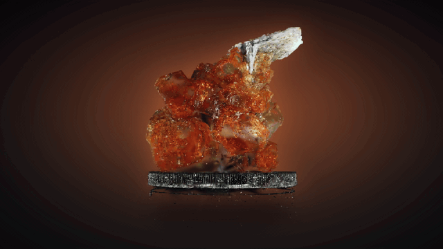
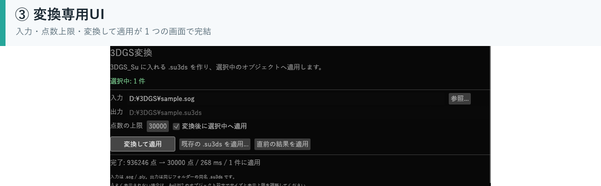

# 3DGS_Su

3DGS（3D Gaussian Splatting）の PLY / SOG を AviUtl2 の 3D 空間に置き、
カメラ制御に同期して動かすカスタムオブジェクトです。

> 作例: “Vanadinite” by Yann de Couëssin（[SuperSplat](https://superspl.at/user/doudoid)）
> / Source: [scene/663d6a97](https://superspl.at/scene/663d6a97) / CC BY 4.0

## AI利用について

スクリプトの一部はAIによって作成されています。問題や改善については私の責任感に従い誠実な対応をするつもりですが、私の能力を超えて対応不能なケースが生じうることをご理解ください。

## 特長

- PLY / SOG を変換して、そのまま 3D 空間に表示
- AviUtl2 のカメラ制御に追従
- 変換専用UIを同梱。追加のソフトは不要
- 通常合成と加算合成に対応
- 360 度スキャン用のパノラマモード

## 動作環境

- AviUtl2 2.1.x（Windows 10 / 11 64bit）
- 追加のランタイムや外部ツールは不要

## インストール

AviUtl2 カタログで `3DGS_Su` を検索してインストールしてください。

手動で入れる場合の配置と、初回起動時の注意は
[インストール](https://github.com/Suzukeh/3DGS_Su/blob/main/docs/install.md) にまとめています。

起動すると `3DGS変換` の専用ウィンドウが開きます。
カスタムオブジェクトに `3DGS_Su` が追加されます。

## 使い方

1. カスタムオブジェクトとして `3DGS_Su` を追加する
2. `3DGS_Su` オブジェクトを選択する
3. 専用ウィンドウの **参照...** で `.sog` または `.ply` を選ぶ
4. **変換して適用** を押す
5. 元ファイルと同じフォルダに `.su3ds` ができ、選択中のオブジェクトに設定される

変換済みの `.su3ds` は **既存の .su3ds を適用...** から使えます。
専用ウィンドウを閉じた場合は、**表示 → 3DGS変換**、
またはオブジェクトの右クリックメニューから開き直せます。

UIの詳しい操作、パラメータ、対応形式は
[使い方](https://github.com/Suzukeh/3DGS_Su/blob/main/docs/usage.md) を参照してください。

## 作例

Vanadinite と、360度スキャンの Infinity Octo Art MK を掲載しています。

[作例を見る](https://github.com/Suzukeh/3DGS_Su/blob/main/docs/samples.md)

## ドキュメント

- [インストール](https://github.com/Suzukeh/3DGS_Su/blob/main/docs/install.md)
- [使い方・パラメータ・対応形式](https://github.com/Suzukeh/3DGS_Su/blob/main/docs/usage.md)
- [.su3ds とは](https://github.com/Suzukeh/3DGS_Su/blob/main/docs/su3ds.md)
- [注意・制限](https://github.com/Suzukeh/3DGS_Su/blob/main/docs/notes.md)
- [作例](https://github.com/Suzukeh/3DGS_Su/blob/main/docs/samples.md)

## ライセンス

このリポジトリのコードは MIT License です（[LICENSE](LICENSE)）。
同梱ライブラリのライセンスは [THIRD_PARTY_LICENSES.md](THIRD_PARTY_LICENSES.md) を参照してください。

作例の **Vanadinite** と **Infinity Octo Art MK** は CC BY 4.0 の素材です。
素材そのものはこのリポジトリに含めていません。
