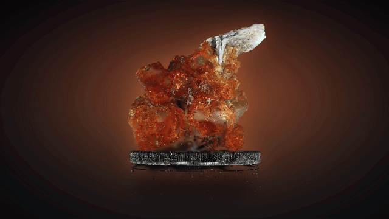
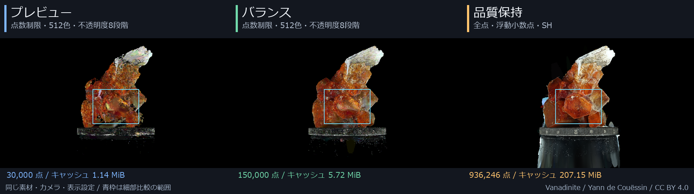

# 3DGS_Su

> [!WARNING]
> **開発のごく初期段階です。** 機能は不完全で、予告なく仕様やファイル形式が変わったり、
> 動作しなくなったりする可能性があります。大事なプロジェクトでは、事前にバックアップを取ってから
> お使いください。

3DGS（3D Gaussian Splatting）の PLY / SOG を AviUtl2 の 3D 空間に置き、
カメラ制御に合わせて動かせるカスタムオブジェクトです。

> 作例: “Vanadinite” by Yann de Couëssin（[SuperSplat](https://superspl.at/user/doudoid)）
> / Source: [scene/663d6a97](https://superspl.at/scene/663d6a97) / CC BY 4.0

## AI利用について

スクリプトの一部はAIによって作成されています。問題や改善については私の責任感に従い誠実な対応をするつもりですが、私の能力を超えて対応不能なケースが生じうることをご理解ください。

## できること

- PLY / SOG を読み込み、AviUtl2 の 3D 空間に表示する
- カメラ制御に合わせて、見る角度や距離が変わる
- 軽さ重視から画質重視まで、3種類の品質テンプレートから選べる
- 変換・向き・大きさ・表示の設定を、AviUtl2 内の専用ウィンドウで操作できる
- 通常合成と加算合成に対応
- 360度スキャンした風景を見回せるパノラマ表示

## 動作環境

- AviUtl2 2.1.x（Windows 10 / 11 64bit）
- 追加のソフトは不要

## インストール

AviUtl2 カタログで `3DGS_Su` を検索してインストールしてください。

手動で入れる方法は [インストール](https://github.com/Suzukeh/3DGS_Su/blob/main/docs/install.md) にあります。

## 使い方

1. カスタムオブジェクト `3DGS_Su` をタイムラインに追加し、選択する
2. **表示 → 3DGS変換** で専用ウィンドウを開く
3. **ファイル参照...** で `.sog` または `.ply` を選ぶ
4. **品質テンプレート** を選び、**変換して適用** を押す

変換が終わると、選択していたオブジェクトに表示されます。
カメラ制御の対象にすると、カメラワークに合わせて動きます。

品質テンプレートは次の3種類です。

| テンプレート | 向いている用途 |
|---|---|
| プレビュー（最大3万点） | 配置やカメラワークの確認。軽い |
| バランス（最大15万点） | 普段の作業 |
| 品質保持（全点） | 仕上げ。変換と描画に時間がかかり、メモリも多く使う |

一度変換したファイル（`.su3ds`）は、**既存の .su3ds を適用...** から別のオブジェクトにも使えます。

詳しい操作と各設定は [使い方](https://github.com/Suzukeh/3DGS_Su/blob/main/docs/usage.md) を参照してください。

## 作例

[Vanadinite のターンテーブルと、風景のパノラマ表示](https://github.com/Suzukeh/3DGS_Su/blob/main/docs/samples.md)

## 品質テンプレートの比較

同じ素材を、同じカメラで各テンプレートから描画しています。

> “Vanadinite” by Yann de Couëssin / Source: [scene/663d6a97](https://superspl.at/scene/663d6a97) / CC BY 4.0

1周する比較動画と細部の拡大は [品質テンプレートの比較](https://github.com/Suzukeh/3DGS_Su/blob/main/docs/quality-presets.md) にあります。

## ドキュメント

- [インストール](https://github.com/Suzukeh/3DGS_Su/blob/main/docs/install.md)
- [使い方・設定・対応形式](https://github.com/Suzukeh/3DGS_Su/blob/main/docs/usage.md)
- [作例](https://github.com/Suzukeh/3DGS_Su/blob/main/docs/samples.md)
- [品質テンプレートの比較](https://github.com/Suzukeh/3DGS_Su/blob/main/docs/quality-presets.md)
- [.su3ds ファイルについて](https://github.com/Suzukeh/3DGS_Su/blob/main/docs/su3ds.md)
- [注意・制限・重いとき](https://github.com/Suzukeh/3DGS_Su/blob/main/docs/notes.md)

不具合や要望は [Issues](https://github.com/Suzukeh/3DGS_Su/issues) へお寄せください。

## ライセンス

MIT License（[LICENSE](https://github.com/Suzukeh/3DGS_Su/blob/main/LICENSE)）。
同梱ライブラリのライセンスは [THIRD_PARTY_LICENSES.md](https://github.com/Suzukeh/3DGS_Su/blob/main/THIRD_PARTY_LICENSES.md) を参照してください。

作例の **Vanadinite** と **Infinity Octo Art MK** は CC BY 4.0 の素材です。
素材そのものは配布物に含めていません。
