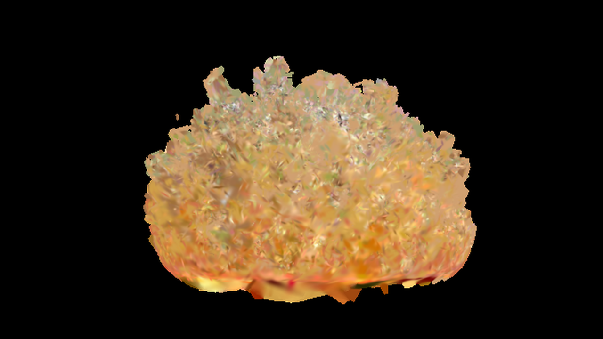

# 3DGS_Su

3DGS（3D Gaussian Splatting）の PLY / SOG を AviUtl2 の 3D 空間に置き、
カメラ制御に同期して動かすカスタムオブジェクトです。



> スクリーンショットの素材: **Homemade Crystal II** by Eric Cornwell
> ([SuperSplat](https://superspl.at/scene/4a84511f)) / CC BY 4.0

## 特長

- 3DGS の各点が持つ 3D 共分散を、視点回転と透視投影のヤコビアンで 2D の楕円に落として描画
- AviUtl2 のカメラ制御（`camera_param`）にそのまま追従
- 色 512 色・不透明度 8 段階を 1 枚のアトラスにまとめ、`drawpoly` をバッチ実行
- 3 万点・640x360 で 1 フレーム 23〜30ms（実測）
- 変換プラグインを同梱。**Python も外部プロセスも不要**

## インストール

### AviUtl2 カタログから

AviUtl2 カタログで `3DGS_Su` を検索してインストールしてください（登録準備中）。

### 手動

配布 zip を展開し、次のように置きます。

```text
data/
  Script/
    3DGS_Su/
      3DGS_Su.obj2
      3DGS_Su_atlas.png
      README.md
  Plugin/
    3DGSConverter_Su/
      three_dgs_converter_su.aux2
      su3ds.exe
```

AviUtl2 を起動し直すと、カスタムオブジェクトに `3DGS_Su`、
編集メニューに「3DGS変換」が追加されます。
初回起動時にプラグインの信頼確認が出た場合は許可してください。

## 使い方

1. カスタムオブジェクトとして `3DGS_Su` を追加する
2. オブジェクトを選択した状態で **編集 → 3DGS変換 → 「3DGSを変換して適用...」**
3. `.sog` または `.ply` を選ぶ
4. 元ファイルと同じフォルダに `.su3ds` ができ、選択中のオブジェクトに設定される

カメラ制御の対象レイヤーに置くと、カメラワークに同期して点群が動きます。
カメラ制御の外では XY 平面へ正射影した表示になります。

### メニュー

| 項目 | 動作 |
|---|---|
| 3DGSを変換して適用... | `.sog` / `.ply` を変換し、選択オブジェクトに設定 |
| 既存の .su3ds を適用... | 変換済みファイルを設定 |
| 直前の変換結果を適用 | 直前に変換したファイルを再適用 |

### コマンドで変換する場合

プラグイン同梱の `su3ds.exe` を使えます。

```bat
su3ds.exe scene.sog -o scene.su3ds
su3ds.exe scene.ply -o scene.su3ds --no-dither
```

`--max` `--fit` `--scale` `--flip-y` `--flip-z` `--no-center` `--no-dither` に対応。

## 対応形式

- **PLY**: binary little endian / big endian / ASCII
  - `x y z`, `f_dc_0..2`（なければ `red green blue`）
  - `opacity`, `scale_0..2`, `rot_0..3`
- **SOG**: PlayCanvas / SuperSplat の zip、または展開フォルダ
  - `meta.json`、WebP 5 枚（means L/U、scales、quats、sh0）

変換時に最大辺が 400 単位になるよう正規化します（`--fit 400`）。
実寸を保つ場合は `--fit 0`。

## パラメータ

| 項目 | 内容 |
|---|---|
| 3DGSファイル | 変換済み `.su3ds` |
| サイズ | 点の大きさの倍率。位置は変えない |
| 不透明度 | 全体の不透明度 |
| 手前クリップ | カメラからの距離がこれ未満の点を捨てる |
| 表示上限 | 読み込んだ点のうち先頭から何点描くか |
| 奥から描く | 通常合成のとき、奥から手前へ並べ替える |
| 楕円 | オフにすると等方の丸い点になる |
| 再読み込み | 0→1 にした瞬間だけ `.su3ds` を読み直す |
| 合成 | 通常（既定）/ 加算 |

## 仕組み

1. 変換時に `scale` と `rot` から 3x3 共分散 `Σ = R S Sᵀ Rᵀ` を作る。
2. 描画時にカメラの前方向・右方向・上方向で視点座標へ移し、
   透視投影のヤコビアン `J` を掛けて 2x2 の画面共分散 `J R Σ Rᵀ Jᵀ` を得る。
3. 2x2 の固有値と固有ベクトルから長軸・短軸・角度を求め、
   カメラ平面に沿った四角形を作る。
4. 色 512 色（各チャンネル 8 段階、暗部を細かく配分）、不透明度 8 段階に量子化し、
   アトラスのセルを UV で選ぶ。

## 性能

90,289 点の SOG を 30,000 点へ変換した実測です。

| 項目 | 結果 |
|---|---:|
| SOG 変換（Rust） | 33 ms |
| PLY 変換（Rust） | 63 ms |
| 描画 30,000 点 / 640x360 | 23〜30 ms |

描画は、レコードの直接参照、6000 四角形ずつの `drawpoly`、
深度の 4096 バケット counting sort で高速化しています。

## 制限

- **SH（視点依存の色）は使いません。** PLY / SOG の DC 成分のみです。
- 色は 512 色、不透明度は 8 段階です。
- Lua のため実用上限はおよそ 3 万点です。
- 通常合成は点単位の painter's sort です。点が交差する場面では完全な前後関係になりません。
- オブジェクト自体の回転・拡大は点群全体に掛かります。

## ビルド

プラグインのソースは `plugin-src/` にあります。

```bash
cd plugin-src
cargo build --release
```

`target/release/three_dgs_converter_su.dll` を
`data/Plugin/3DGSConverter_Su/three_dgs_converter_su.aux2` にコピーしてください。
`su3ds.exe` も同じフォルダに置くと CLI とバッチ変換で使えます。

配布 zip は次で作れます。

```bash
python build_release.py --version v0.2.0
```

## 検証

AviUtl2 2.1.14 の独立検証本体で確認しています。

- 合成 3,600 点: 可視 51,311px、カメラ X 0→300 で赤 +25.5px / 青 -5.6px
- 実 SOG / PLY 30,000 点: SOG と PLY の描画差は平均 0.0 / 最大 1
- 変換プラグイン経由の SOG 90,289 点 → 30,000 点が、Python 参照実装とバイト単位一致
- 本体ログに ERROR / WARN なし

## ライセンス

このリポジトリのコードは MIT License です（`LICENSE`）。
同梱の Rust クレートのライセンスは `THIRD_PARTY_LICENSES.md` を参照してください。

スクリーンショットの **Homemade Crystal II** は Eric Cornwell 氏の CC BY 4.0 素材です。
素材そのものはこのリポジトリに含めていません。

## 制作について

スクリプトの一部はAIによって作成されています。問題や改善については私の責任感に従い誠実な対応をするつもりですが、私の能力を超えて対応不能なケースが生じうることをご理解ください。
