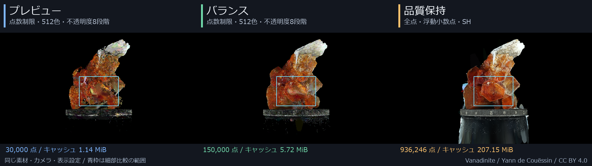
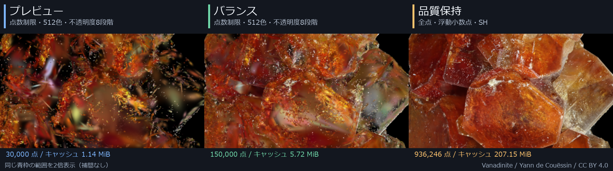

# 品質テンプレートの比較

[READMEへ戻る](../README.md) / [使い方](usage.md) / [作例](samples.md)

**3DGS変換** ウィンドウの **品質テンプレート** で、軽さと画質のバランスを選べます。

> スクリプトの一部はAIによって作成されています。問題や改善については私の責任感に従い誠実な対応をするつもりですが、私の能力を超えて対応不能なケースが生じうることをご理解ください。

## 3種類のテンプレート

| テンプレート | 点の数 | 色・不透明度 | 見る角度による色の変化（SH） | 向いている用途 |
|---|---:|---|---|---|
| **プレビュー** | 最大30,000点 | 簡略化（512色・8段階） | なし | 配置やカメラワークの確認 |
| **バランス** | 最大150,000点 | 簡略化（512色・8段階） | なし | 普段の作業 |
| **品質保持** | 全点 | 元データのまま | 元データにあれば再現 | 仕上げ |

**品質保持は、変換・描画に時間がかかり、メモリも多く使います。** 品質保持でも、元のビューアと完全に同じ見た目になるわけではありません。

## 同じ素材・同じカメラでの比較

Vanadinite（約94万点）を各テンプレートで変換し、同じカメラ・同じ設定で 3DGS_Su から描画しています。

### 1周する動画

1280×720・30fps・6秒で、360度を1周します。

| テンプレート | 色を比べる用（RGB） | 手軽に見る用 |
|---|---|---|
| プレビュー | [ダウンロード](https://github.com/Suzukeh/3DGS_Su/releases/download/v0.5.1/3DGS_Su-quality-preview-rgb.mp4) | [ダウンロード](https://github.com/Suzukeh/3DGS_Su/releases/download/v0.5.1/3DGS_Su-quality-preview-web.mp4) |
| バランス | [ダウンロード](https://github.com/Suzukeh/3DGS_Su/releases/download/v0.5.1/3DGS_Su-quality-balanced-rgb.mp4) | [ダウンロード](https://github.com/Suzukeh/3DGS_Su/releases/download/v0.5.1/3DGS_Su-quality-balanced-web.mp4) |
| 品質保持 | [ダウンロード](https://github.com/Suzukeh/3DGS_Su/releases/download/v0.5.1/3DGS_Su-quality-preserve-rgb.mp4) | [ダウンロード](https://github.com/Suzukeh/3DGS_Su/releases/download/v0.5.1/3DGS_Su-quality-preserve-web.mp4) |

色を比べる用（RGB）は、描画した色を劣化させずに保存した動画です（約45〜49MB）。ブラウザや一部のプレーヤーでは再生できないため、VLC などで開いてください。
手軽に見る用は一般的な MP4（約7MB）で、どのプレーヤーでも再生できますが、色は少し変わります。

### 同じ視点の静止画

### 細部の拡大

全体図の青枠の範囲を2倍に拡大しています。

この素材では、プレビューは点がまばらで、結晶の細部や台座が欠けています。バランスは点が増えますが、色の段階はプレビューと同じです。品質保持では結晶の面や濃淡が残ります。ただし、元データに含まれるノイズはそのまま残ります。

原寸の画像（1280×720）：[プレビュー](quality-presets/preview.png) / [バランス](quality-presets/balanced.png) / [品質保持](quality-presets/preserve.png)

### ファイルサイズ

| テンプレート | 点の数 | `.su3ds` の大きさ |
|---|---:|---:|
| プレビュー | 30,000点 | 約1.1MB |
| バランス | 150,000点 | 約5.7MB |
| 品質保持 | 936,246点 | 約207MB |

品質保持は1点あたりの情報も多いため、点の数の比率以上に大きくなります。

比較の条件

- 入力：Vanadinite、936,246点、SHあり
- 変換：一番長い辺を400に正規化、倍率1、中心合わせあり、反転なし
- 表示：サイズ1、不透明度1、手前クリップ10、表示上限0（全点）、通常合成、楕円、奥から描く
- 1280×720、黒背景、同じカメラ制御

見た目や処理の重さは、素材・カメラ・画面サイズ・PCによって変わります。

## テンプレートを使うときの注意

- テンプレートを選んだだけでは、オブジェクトの表示は変わりません。**変換して適用** を押すと反映されます
- テンプレートが変えるのは、点の数・色の保存方法・SH・表示上限です。入力・出力先、大きさや向きの設定はそのまま残ります
- **変換の詳細設定** で品質に関わる項目を変えると、表示が **カスタム** になります

## 素材・ライセンス

“Vanadinite” by Yann de Couëssin（[SuperSplat](https://superspl.at/user/doudoid)）
/ Source: [scene/663d6a97](https://superspl.at/scene/663d6a97) / [CC BY 4.0](https://creativecommons.org/licenses/by/4.0/)

元モデルは配布物に含めていません。掲載している画像と動画は、この素材を 3DGS_Su で描画したものです。
