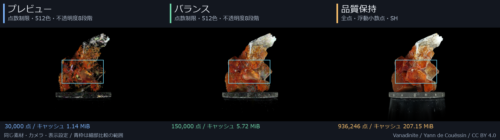
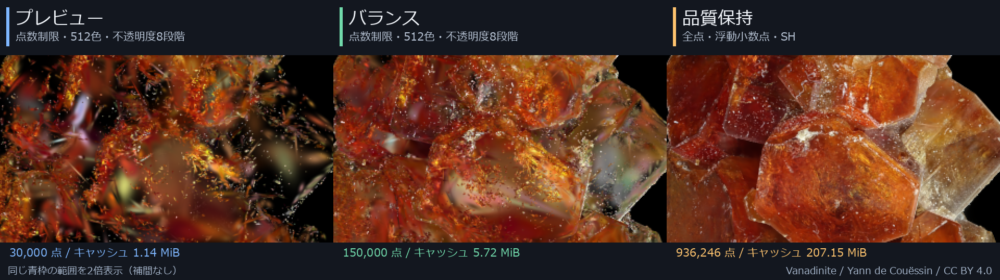

# 品質テンプレートと比較作例

[READMEへ戻る](../README.md) / [使い方](usage.md) / [ほかの作例](samples.md)

**3DGS変換 → 品質テンプレート** で、軽く確認する設定から、入力の情報をなるべく残す設定まで選べます。

> スクリプトの一部はAIによって作成されています。問題や改善については私の責任感に従い誠実な対応をするつもりですが、私の能力を超えて対応不能なケースが生じうることをご理解ください。

## 3種類のテンプレート

| テンプレート | 変換で残す点 | 色・不透明度 | 視点による色（SH） | 使いどころ |
|---|---:|---|---|---|
| **プレビュー** | 最大30,000点 | 512色・不透明度8段階、ディザあり | 保存しない | 読み込み、配置、カメラワークの確認 |
| **バランス** | 最大150,000点 | 512色・不透明度8段階、ディザあり | 保存しない | プレビューより密度を上げ、負荷を抑えて作業 |
| **品質保持** | 有効な全点 | 浮動小数点RGB・不透明度 | 入力にあれば保持 | 追加の間引き・色と不透明度の量子化を避けて仕上げる |

どのテンプレートも **表示上限を0（全点）** にします。変換後のファイルに残った点を、表示側でもう一度間引かないためです。

**品質保持は処理時間とメモリを多く使います。** 元のビューアと画素単位で一致したり、元の写真を復元したりする設定ではありません。SHがない入力からSHを生成することもありません。

## 同じ素材・同じ視点で比較

すべて **3DGS_Suで実際に描画した作例** です。同じVanadiniteを各テンプレートで変換し、カメラ、向き、大きさ、表示設定を揃えています。

### 1周するMP4（品質比較用）

各設定で360度を1周する、**1280×720・30fps・6秒（180フレーム）** の動画です。フレームの複製や補間でfpsを増やさず、すべての視点を実際に描画しています。縮小画像を拡大した動画ではありません。

| テンプレート | 色の比較用：RGBロスレス | 再生互換性を優先：通常MP4 |
|---|---|---|
| プレビュー | [RGB MP4](https://github.com/Suzukeh/3DGS_Su/releases/download/v0.5.1/3DGS_Su-quality-preview-rgb.mp4) | [通常MP4](https://github.com/Suzukeh/3DGS_Su/releases/download/v0.5.1/3DGS_Su-quality-preview-web.mp4) |
| バランス | [RGB MP4](https://github.com/Suzukeh/3DGS_Su/releases/download/v0.5.1/3DGS_Su-quality-balanced-rgb.mp4) | [通常MP4](https://github.com/Suzukeh/3DGS_Su/releases/download/v0.5.1/3DGS_Su-quality-balanced-web.mp4) |
| 品質保持 | [RGB MP4](https://github.com/Suzukeh/3DGS_Su/releases/download/v0.5.1/3DGS_Su-quality-preserve-rgb.mp4) | [通常MP4](https://github.com/Suzukeh/3DGS_Su/releases/download/v0.5.1/3DGS_Su-quality-preserve-web.mp4) |

**品質を判定する場合はRGBロスレス版をダウンロードしてください。** 描画した8bit RGBの値を、RGB→YUV変換や色差の間引きなしで保存しています。復号した全フレームの画素が元の連番と一致することを確認しています。入力の浮動小数点やHDR値を、そのまま動画に保存するという意味ではありません。

RGB版はH.264のHigh 4:4:4 Predictive形式です。ブラウザや一部プレーヤーでは再生できない場合があります。通常版はH.264・色差4:2:0で再生互換性を優先していますが、色の厳密な比較には使わないでください。

GIFは色数とfpsを抑えた手軽な作例として、[動き・パノラマの作例](samples.md)に残しています。品質比較にはGIFを使っていません。

### 同じ視点の静止画

### 同じ範囲の細部

全体図の青枠内、320×180ピクセルを各640×360ピクセルへ拡大しています。2倍、補間なしです。

この素材では、プレビューは点が疎で、結晶の細部や台座が欠けています。バランスは密度が増しますが、色・不透明度の段階はプレビューと同じです。品質保持では結晶の面や濃淡が残る一方、入力由来のノイズまでなくなるわけではありません。

### この作例の点数とファイルサイズ

| テンプレート | 保存した点数 | `.su3ds` の容量 |
|---|---:|---:|
| プレビュー | 30,000点 | 1.14 MiB |
| バランス | 150,000点 | 5.72 MiB |
| 品質保持 | 936,246点 | 207.15 MiB |

容量はこの素材のファイルサイズで、描画時のメモリ使用量ではありません。品質保持は1点あたりに保存する情報も多いため、点数の比率以上に容量が増えます。

原寸PNG（1280×720、動画の先頭フレームと同じ画素）：[プレビュー](quality-presets/preview.png) / [バランス](quality-presets/balanced.png) / [品質保持](quality-presets/preserve.png)

比較条件

- 入力：Vanadinite、936,246点、SHあり
- 3種類とも最大辺400へ正規化、倍率1、中心合わせあり、Y/Z反転なし
- シーン：1280×720。静止画も同じ1280×720で、拡大縮小していない
- 動画：ネイティブ1280×720のRGB、30fps、180フレームで360度。3種類とも同じ角度・速度・開始位置
- 同じカメラ制御と黒背景。通常合成、楕円表示、奥から描画
- サイズ1、不透明度1、手前クリップ10、表示上限0、パノラマなし
- 全体図は各PNGを同じ倍率で縮小。細部は3枚の同じ座標を切り出し

見た目や処理負荷は素材、カメラ、表示サイズ、PC環境で変わります。この作例がすべての素材での画質を保証するものではありません。

## 使い方と個別調整

1. **3DGS変換** で入力の `.ply` / `.sog` またはSOGフォルダを選ぶ
2. **品質テンプレート** を選ぶ
3. 必要なら **変換の詳細設定** を開き、向き・大きさなどを調整する
4. 対象の `3DGS_Su` オブジェクトを選択し、**変換して適用** を押す

テンプレートを選んだだけでは、選択中のオブジェクトは変わりません。変換・適用するまで反映されません。

テンプレートが変えるのは、変換の品質、点数上限、ディザ、SH、表示上限です。入力・出力先、正規化・倍率・中心・反転、不透明度などのほかの表示設定、自動適用の選択は保ちます。

さらに調整する場合は、折りたたまれた **変換の詳細設定** と **表示設定** を開いてください。変換形式の **軽量／品質優先** も手動で選べます。品質保持テンプレートが使う変換形式は **品質優先** です。

品質に関係する設定がテンプレートと異なると、表示は **カスタム** になります。変換形式によって使われない項目や、すべての点を表示できる上限の違いは、同じ実効設定として扱います。変換・表示設定は次回起動時にも復元します。

## 素材・ライセンス

“Vanadinite” by Yann de Couëssin（[SuperSplat](https://superspl.at/user/doudoid)）
/ Source: [scene/663d6a97](https://superspl.at/scene/663d6a97) / [CC BY 4.0](https://creativecommons.org/licenses/by/4.0/)

元モデルは同梱していません。掲載画像は、この素材を3DGS_Suで描画したものです。
