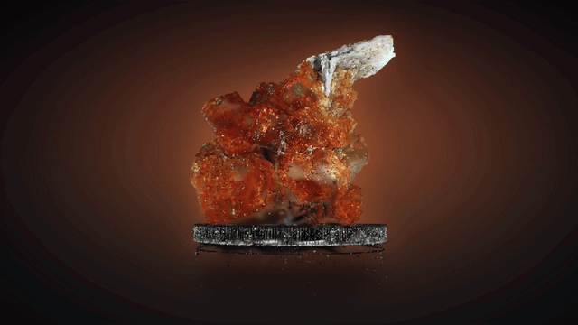
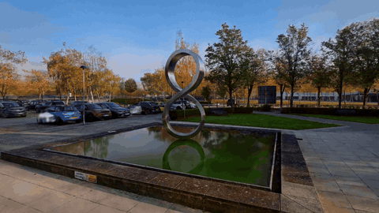

# 作例

[READMEへ戻る](../README.md)

どれも 3DGS_Su で AviUtl2 上に描画したものです。

## Vanadinite

[MP4で見る](vanadinite.mp4)

“Vanadinite” by Yann de Couëssin（[SuperSplat](https://superspl.at/user/doudoid)）
/ Source: [scene/663d6a97](https://superspl.at/scene/663d6a97) / CC BY 4.0

## 風景: Infinity Octo Art MK

[MP4で見る](infinity-octo.mp4)

“Infinity Octo Art MK ( Wendy Taylor's Octo Art )” by Natural Splats
（[SuperSplat](https://superspl.at/user/naturalsplats)）
/ Source: [scene/94b17a0d](https://superspl.at/scene/94b17a0d) / CC BY 4.0

> パノラマ表示で、200万点のうち50万点を使い、水平画角100度で見回しています。

GIF は色数を減らしています。色や滑らかさは MP4 で確認してください。

テンプレートごとの画質の違いは [品質テンプレートの比較](quality-presets.md) にあります。
