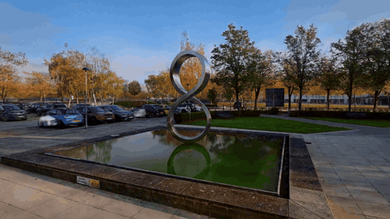
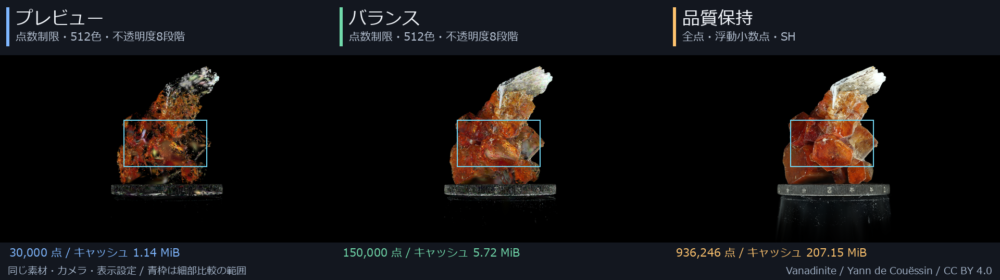

# 作例

[READMEへ戻る](../README.md)

GIFは手軽に動きを見るための作例です。色や滑らかさの品質比較には、後半の30fps MP4を使ってください。

## Vanadinite

[作例のMP4](vanadinite.mp4)

“Vanadinite” by Yann de Couëssin（[SuperSplat](https://superspl.at/user/doudoid)）
/ Source: [scene/663d6a97](https://superspl.at/scene/663d6a97) / CC BY 4.0

## 風景: Infinity Octo Art MK

[作例のMP4](infinity-octo.mp4)

“Infinity Octo Art MK ( Wendy Taylor's Octo Art )” by Natural Splats
（[SuperSplat](https://superspl.at/user/naturalsplats)）
/ Source: [scene/94b17a0d](https://superspl.at/scene/94b17a0d) / CC BY 4.0

> 風景例は3DGS_Suのパノラマモードで表示しています。
> 200万点のうち50万点を使い、水平画角100度で見ています。

## 品質テンプレートの比較

同じVanadiniteを、同じカメラ・表示設定で3DGS_Suから描画しています。各設定で360度を1周する **1280×720・30fps・6秒** のMP4です。

| テンプレート | 品質比較用：RGBロスレスMP4 | 通常再生用：MP4 |
|---|---|---|
| プレビュー | [RGB版をダウンロード](https://github.com/Suzukeh/3DGS_Su/releases/download/v0.5.1/3DGS_Su-quality-preview-rgb.mp4) | [通常版](https://github.com/Suzukeh/3DGS_Su/releases/download/v0.5.1/3DGS_Su-quality-preview-web.mp4) |
| バランス | [RGB版をダウンロード](https://github.com/Suzukeh/3DGS_Su/releases/download/v0.5.1/3DGS_Su-quality-balanced-rgb.mp4) | [通常版](https://github.com/Suzukeh/3DGS_Su/releases/download/v0.5.1/3DGS_Su-quality-balanced-web.mp4) |
| 品質保持 | [RGB版をダウンロード](https://github.com/Suzukeh/3DGS_Su/releases/download/v0.5.1/3DGS_Su-quality-preserve-rgb.mp4) | [通常版](https://github.com/Suzukeh/3DGS_Su/releases/download/v0.5.1/3DGS_Su-quality-preserve-web.mp4) |

色を見るときは **RGBロスレス版** を使ってください。RGB版は再生ソフトによっては対応していないため、その場合は対応するプレーヤーで開いてください。通常版は再生互換性を優先した色差4:2:0の圧縮動画です。

“Vanadinite” by Yann de Couëssin / Source: [scene/663d6a97](https://superspl.at/scene/663d6a97) / CC BY 4.0

[細部の拡大・テンプレートの設定・点数と容量・原寸PNG](quality-presets.md)
