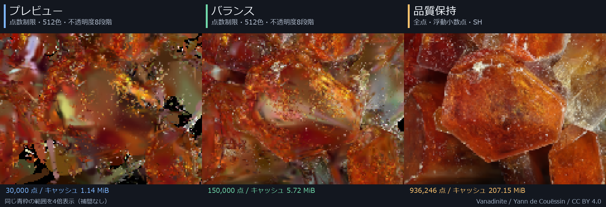
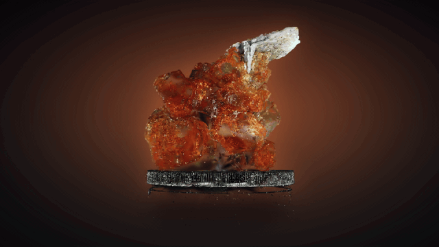

# 作例

[READMEへ戻る](../README.md)

## 品質テンプレートの比較

同じVanadiniteを、同じカメラ・表示設定で3DGS_Suから描画した比較です。

“Vanadinite” by Yann de Couëssin / Source: [scene/663d6a97](https://superspl.at/scene/663d6a97) / CC BY 4.0

[テンプレートの設定・点数と容量・原寸PNG](quality-presets.md)

## Vanadinite

“Vanadinite” by Yann de Couëssin（[SuperSplat](https://superspl.at/user/doudoid)）
/ Source: [scene/663d6a97](https://superspl.at/scene/663d6a97) / CC BY 4.0

## 風景: Infinity Octo Art MK

“Infinity Octo Art MK ( Wendy Taylor's Octo Art )” by Natural Splats
（[SuperSplat](https://superspl.at/user/naturalsplats)）
/ Source: [scene/94b17a0d](https://superspl.at/scene/94b17a0d) / CC BY 4.0

> 風景例は3DGS_Suのパノラマモードで表示しています。
> 200万点のうち50万点を使い、水平画角100度で見ています。
