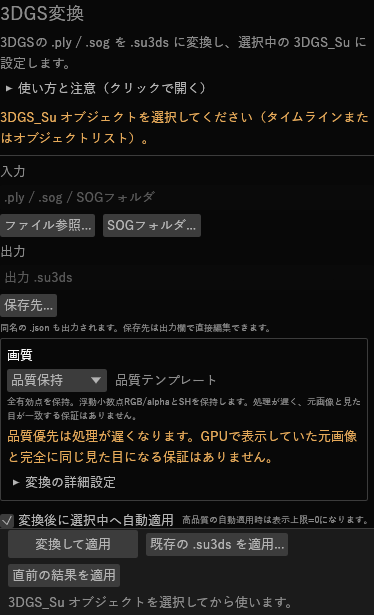

# 使い方

[READMEへ戻る](../README.md)

## 基本の流れ

変換と設定は、すべて **3DGS変換** ウィンドウで行います。

1. カスタムオブジェクト `3DGS_Su` をタイムラインに追加し、選択する
2. **表示 → 3DGS変換** でウィンドウを開く
3. **ファイル参照...**（または **SOGフォルダ...**）で入力を選ぶ
4. **品質テンプレート** を選ぶ
5. **変換して適用** を押す

変換が終わると、変換を始めたときに選択していたオブジェクトに表示されます。
変換中にシーンやプロジェクトを切り替えた場合は、自動では設定しません。**直前の結果を適用** で設定してください。

| ボタン | 動作 |
|---|---|
| 変換して適用 | 入力を変換し、選択中のオブジェクトに設定する |
| 既存の .su3ds を適用... | 変換済みのファイルを選び、選択中のオブジェクトに設定する |
| 直前の結果を適用 | 最後に変換したファイルを、選択中のオブジェクトに設定する |

**変換後に選択中へ自動適用** をオフにすると、ボタンは **変換** になり、変換だけを行います。

変換中はウィンドウ上部に進み具合が出ます。**中止** を押すと止まり、途中のファイルは残りません。

**変換の詳細設定** と **表示設定** は、見出しをクリックすると開きます。
ウィンドウが狭いときは、入力欄とボタンが縦に並びます。実行ボタンはウィンドウ下端に固定されています。

## 品質テンプレート

| テンプレート | 点の数 | 色 | 向いている用途 |
|---|---:|---|---|
| プレビュー | 最大3万点 | 簡略化 | 配置やカメラワークの確認 |
| バランス | 最大15万点 | 簡略化 | 普段の作業 |
| 品質保持 | 全点 | 元データに近い色。見る角度による色の変化も再現 | 仕上げ |

品質保持は、変換・描画に時間がかかり、メモリとファイル容量も大きくなります（例：約94万点の素材で約207MB）。
実際の見た目の違いは [品質テンプレートの比較](quality-presets.md) を参照してください。

テンプレートを選んだだけでは、オブジェクトの表示は変わりません。**変換して適用** を押すと反映されます。

## 変換の詳細設定

テンプレートより細かく調整したいときに使います。
品質に関わる項目を変えると、テンプレートの表示が **カスタム** になります。

| 項目 | 内容 |
|---|---|
| 変換形式 | **軽量**（色を簡略化して小さく保存）または **品質優先**（色と点を元データのまま保存） |
| 全点／点数の上限 | 軽量で保存する点の数。0は無制限 |
| 正規化／元のサイズ | 一番長い辺を指定サイズ（既定400）に揃えるか、元の大きさのままにするか |
| 倍率・中心 | 大きさと、原点に中心を合わせるか |
| Y反転・Z反転 | 上下や前後が逆に見えるときに使う |
| ディザ | 軽量で色の段差を目立たなくする |
| SH | 見る角度による色の変化を保存する（品質優先のみ） |
| 出力先 | 変換したファイルの保存先。既定では入力と同じ場所 |

同じ名前のファイルがすでにある場合は、上書きしてよいか確認されます。

## 表示設定

オブジェクトの見た目を調整します。ウィンドウの **表示設定** で **選択中から読込** を押して現在の値を読み込み、調整してから **選択中へ適用** を押します。
同じ項目は、オブジェクトの設定ダイアログからも変更できます。

| 項目 | 内容 |
|---|---|
| 3DGSファイル | 表示する `.su3ds` |
| サイズ | 点の大きさの倍率。位置は変わらない |
| 不透明度 | 全体の不透明度 |
| 手前クリップ | カメラからこの距離より近い点を表示しない |
| 表示上限 | 描画する点の数。**0は全点**。作業中に下げると軽くなる |
| 奥から描く | 通常合成のとき、奥の点から順に描く |
| 楕円 | オフにすると丸い点で描く |
| パノラマ | 360度スキャンの風景を、カメラの向きで見回す表示 |
| 画角 | パノラマのときの水平方向の画角（度） |
| 再読み込み | 0→1 にしたときに `.su3ds` を読み直す。同じファイルを再変換したあとに使う |
| 合成 | 通常（既定）／加算 |

## カメラ制御

カメラ制御の対象にすると、カメラワークに合わせて点群が立体的に動きます。
カメラ制御の外に置いた場合は、正面から見た平面的な表示になります。

## 対応形式

### PLY

一般的な 3DGS 用の PLY（binary / ASCII）に対応します。
位置・色・不透明度・大きさ・回転の情報が必要です。点群だけの PLY（色付き点のみ）は表示できません。

### SOG

PlayCanvas / SuperSplat の SOG に対応します。zip のまま、または展開したフォルダを選べます。

## 変換したファイル

- 変換すると `.su3ds` と、同じ名前の `.json`（元ファイル名や点数の記録）ができます
- `.su3ds` は何度でも使えます。品質や向きを変えたいときは、元の PLY / SOG から変換し直してください
- 元の PLY / SOG は残しておいてください
- ウィンドウの設定は次回起動時にも引き継がれます。オブジェクトの設定はプロジェクトに保存されます
