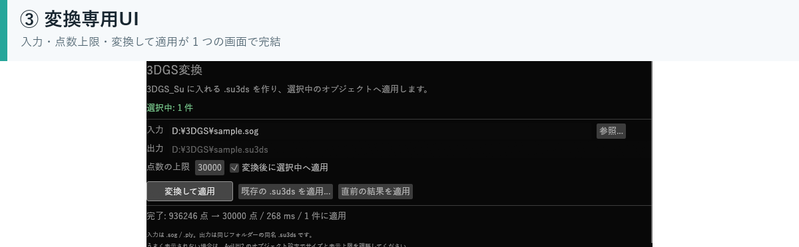
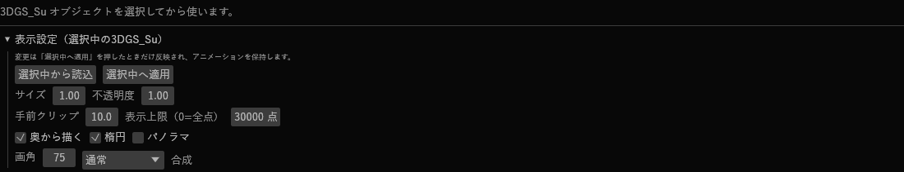

# 使い方

[READMEへ戻る](../README.md)

## 変換専用UI

1. `3DGS_Su` オブジェクトをタイムラインに追加する
2. オブジェクトを選択する
3. **参照...** で `.sog` または `.ply` を選ぶ
4. 必要なら **点数の上限** を変え、**変換して適用** を押す
5. 元ファイルと同じフォルダに `.su3ds` ができ、選択中のオブジェクトに設定される

| ボタン | 動作 |
|---|---|
| 変換して適用 | `.sog` / `.ply` を変換し、選択中のオブジェクトに設定 |
| 既存の .su3ds を適用... | 変換済みの `.su3ds` を設定 |
| 直前の結果を適用 | 直前に変換したファイルを再適用 |

変換専用UIを閉じた場合は、**表示 → 3DGS変換**、
またはオブジェクトの右クリックメニューから開き直せます。

## オブジェクト設定

| 項目 | 内容 |
|---|---|
| 3DGSファイル | 変換済みの `.su3ds` |
| サイズ | 点の大きさの倍率。位置は変えない |
| 不透明度 | 全体の不透明度 |
| 手前クリップ | カメラからの距離がこれ未満の点を捨てる |
| 表示上限 | 読み込んだ点のうち先頭から何点描くか |
| 奥から描く | 通常合成のとき、奥から手前へ並べ替える |
| 楕円 | オフにすると等方の丸い点になる |
| パノラマ | 360度スキャン用の球面投影。カメラの向きで見回す |
| 画角 | パノラマ時の水平画角（度） |
| 再読み込み | 0→1 にした瞬間だけ `.su3ds` を読み直す |
| 合成 | 通常（既定）/ 加算 |

## カメラ制御

カメラ制御の対象レイヤーに置くと、カメラワークに同期して点群が動きます。
カメラ制御の外では XY 平面へ正射影した表示になります。

表示サイズは **サイズ**、描画する点の数は **表示上限** で調整できます。

## 対応形式

### PLY

- binary little endian
- binary big endian
- ASCII

必要なプロパティは `x y z`、`f_dc_0..2`（なければ `red green blue`）、
`opacity`、`scale_0..2`、`rot_0..3` です。

### SOG

- PlayCanvas / SuperSplat の zip
- 展開済みフォルダ

`meta.json` と WebP 5枚（means L/U、scales、quats、sh0）を読みます。

変換時は最大辺が400単位になるよう正規化します。
実寸を保ちたい場合は、コマンド版の `su3ds.exe` で `--fit 0` を指定してください。

## 変換について

- 入力ファイルと同じフォルダに、同名の `.su3ds` を作ります
- 変換時に同名の `.json` も作り、元ファイルや点数、範囲を記録します
- 既存の `.su3ds` がある場合は上書きされます
- 変換専用UIの **点数の上限** は、既定で30,000点です
